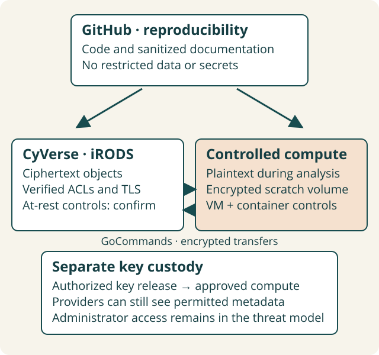
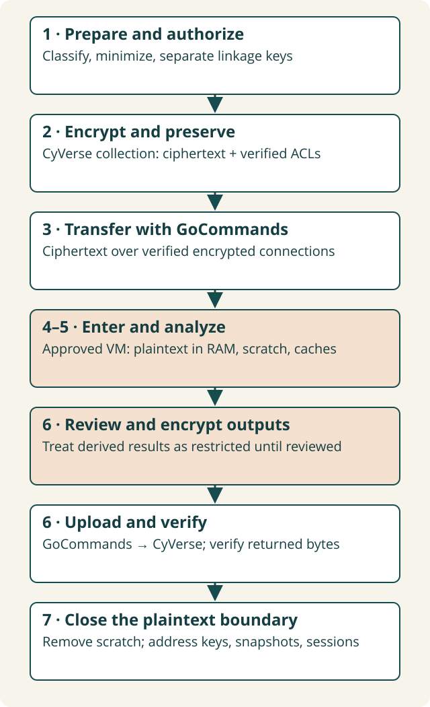
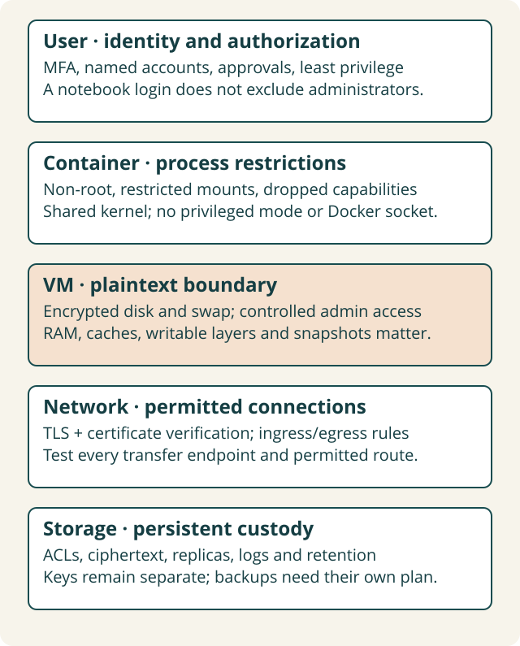

# Working with Sensitive and Restricted Data

*Secure storage, transfer, analysis, and preservation using OASIS infrastructure.*

Environmental research often needs information that cannot be openly shared: confidential agricultural measurements, private landowner records, sensitive species coordinates, restricted ecological observations, environmental monitoring records, proprietary datasets, personally identifiable information, or linkage keys. A reproducible workflow can keep methods open while controlling access to these records.

This guide extends the [Cloud Reproducibility Triangle](cloud.md): **GitHub → temporary compute → CyVerse Data Store**. Read that introduction for ordinary setup; use this guide to identify the additional controls, evidence, and authorization your project needs. Start with [classification](#choose-the-right-workflow), then use the [seven-stage lifecycle](#the-secure-data-lifecycle), [synthetic tutorial](#practice-with-synthetic-data), and [approval process](#obtain-approval-before-processing).

!!! warning "Authorization comes before restricted data"
    **Do not upload restricted data to CyVerse until the data provider and responsible institutional authorities have confirmed that the proposed environment is appropriate.** Agreements or regulated data may require a designated computing environment. Encryption does not override those requirements. Use synthetic data until approvals cover storage, transfer, compute, administrators, and preservation.

## Why sensitive data require different workflows

Open science encourages sharing data, notebooks, maps, and intermediate results. For sensitive research, each of these can disclose information. A precise coordinate can identify a private property or vulnerable ecological resource without naming a person. Joining a land parcel layer to observations can reveal an owner; combining two innocuous tables can create an identifying record. Consider the combined dataset and likely external information, not just each source in isolation.

**Privacy** concerns appropriate use of information about people. **Confidentiality** means information is available only to authorized parties; it also applies to species, proprietary methods, or locations. **Security** comprises safeguards for confidentiality, integrity, and availability. **Compliance** means satisfying applicable obligations and approval processes. A security feature alone establishes none of the others.

### Choose the right workflow

These working categories support discussion; map them to your institution's actual classification scheme. They are not a substitute for that scheme.

| Working category | Examples | Decision |
| --- | --- | --- |
| Public | Released weather records, approved open datasets | Standard Triangle, with licensing, provenance, and integrity checks. |
| Private but unrestricted | Unpublished work with no special sharing prohibition | Standard infrastructure may be suitable with private access and ordinary institutional safeguards; confirm consent and publication plans. |
| Confidential | Landowner details, commercially sensitive observations, vulnerable species locations | Document disclosure risks; obtain a control plan and environment decision from the custodian and institution. |
| Restricted | Data-use agreements, regulated identifiers, export restrictions, mandated enclaves | Stop before transfer. Obtain explicit environment approval; use a different approved service if OASIS components cannot meet requirements. |

If classification is uncertain, ask the custodian and institutional research security team. Do not downgrade a dataset because names have been removed. At CU Boulder, consult [Research Computing's classification guidance](https://curc.readthedocs.io/en/latest/cloud/aws/lca1/data-classification.html) and [secure research computing resources](https://www.colorado.edu/rc/secure-research-computing-resources). Their availability does not imply that any particular project is approved.

### Four states to record for every control

| State | Meaning | Example evidence |
| --- | --- | --- |
| **Supported** | Technology provides a capability. | Versioned documentation for iRODS ACLs. |
| **Configured** | Capability is enabled in the proposed environment. | Reviewed collection ACLs and client settings. |
| **Verified** | A test demonstrates the intended behavior. | Authorized reader succeeds; test account is denied. |
| **Approved** | Responsible authority authorizes this use. | Written approval naming dataset, services, users, and conditions. |

Record these states separately, with an owner, date, and evidence reference. Unknown is an unresolved control, not a pass. Revalidate when users, images, transfer clients, endpoints, or agreements change.

## A secure Cloud Reproducibility Triangle



[Open the full-size diagram](../assets/diagrams/sensitive-data/secure-triangle.svg).

*The diagram describes a target architecture, not an attestation about a live OASIS deployment. Ordinary analysis exposes plaintext even when its backing volume is encrypted.*

### GitHub: reproducible methods without disclosure

Keep code, environment manifests, image digests, and sanitized documentation public when authorized. Public repositories must exclude restricted records, credentials, encryption keys, confidential notebook outputs, sensitive metadata, and files enabling reidentification. A private repository also needs explicit authorization before receiving restricted content.

Keep datasets outside the repository directory. Use `.gitignore`, notebook output review, secret scanning, and explicit staging as additional safeguards. `.gitignore` does not remove already tracked files or protect Git history. Review commit diffs, notebooks, generated HTML, CI artifacts, logs, Git LFS, and published websites. Store detailed security evidence privately: paths, ACLs, and user registers can themselves be sensitive. If a secret is committed, revoke it and follow incident procedures; deleting the current file is insufficient.

### CyVerse Data Store: persistent custody through iRODS

[CyVerse documents Data Store access](https://learning.cyverse.org/ds/) and [GoCommands permission management](https://learning.cyverse.org/ds/gocommands/access_management/). iRODS ACLs distinguish read, write, and ownership permissions for users and groups; inheritance affects new objects. Authentication identifies a user; authorization decides what they can access. Review effective group membership, public access, tickets, and administrator privileges as well as direct ACLs.

Private collections do **not** prove encryption at rest. Client-side encryption can protect content before upload, but storage-level encryption, replicas, backup restoration, audit coverage, geographic placement, and deletion timelines need separate confirmation. iRODS supports resource and rule-based data management; ask CyVerse which replication and auditing policies apply to your collection. A replica is not an independent backup or a retention guarantee. Checksums can detect accidental corruption; they do not by themselves authenticate a maliciously altered object.

Before approval, request written answers on storage encryption and keys, authentication/MFA for the actual access route, administrator access, audit events and availability, replica/backup locations and encryption, recovery tests, retention/trash behavior, and incident notification. These deployment facts remain **unconfirmed in this guide**.

### Containerized compute: a controlled plaintext environment

An authenticated Jupyter interface controls one entry point. It does not exclude the VM owner, hypervisor operator, storage administrator, or someone with Docker daemon access. A container shares the host kernel and is one layer of isolation; a VM adds another layer but does not eliminate provider administration.

Identify who operates your specific DE/VICE app or VM and where it runs. Confirm encrypted working volumes, swap, snapshots, temporary files, network restrictions, image provenance, secret release, logs, and termination behavior. Use an approved image and short-lived, narrowly scoped credentials through an approved secret service or protected runtime mount. Do not bake keys into images or paste tokens into notebooks. [Jetstream2 gateway guidance](https://docs.jetstream-cloud.org/general/gateways/) calls for specific authorization for protected information; this guide makes no certification claim about CyVerse, Jetstream2, or OASIS.

## The secure data lifecycle

**CyVerse Data Store → GoCommands → containerized VM → analysis → GoCommands → CyVerse Data Store.** Plan the entire path, including the authorized source environment where encryption happens.



[Open the full-size diagram](../assets/diagrams/sensitive-data/data-lifecycle.svg).

*Ciphertext and plaintext are explicitly labeled. Network encryption protects the transfer path; file encryption protects content before and after transfer.*

### 1. Prepare the data

**What happens:** The custodian classifies inputs and proposed combinations, authorizes a purpose, minimizes fields, and separates direct identifiers and linkage keys from routine analytical records.

**What could go wrong:** Unnecessary identifiers, sensitive filenames, or joins expand disclosure risk; a data-use agreement prohibits the selected service.

**Protections:** Define allowed users, purposes, locations, retention, outputs, and linkage operations before receiving data. Use pseudonymous records where practical; their classification may remain restricted.

**Verify:** Have the custodian review a synthetic schema, fields, joins, and proposed data flow against the agreement.

**Retain:** Classification worksheet, agreement references, minimized schema, environment decision, named approvals. Keep identifiers out of public evidence.

### 2. Store data securely

**What happens:** Ciphertext is preserved in a restricted collection with intended users and groups.

**What could go wrong:** Inherited access, a public ticket, misplaced keys, unencrypted replicas, or an undocumented backup copies data outside approved custody.

**Protections:** Audit parent and child ACLs, limit ownership, separate keys, use required at-rest controls, and document replication, recovery, and retention. Do not rely on a folder name such as `private`.

**Verify:** Test a permitted account and a separate non-member test account with synthetic objects. Inspect ACLs after upload and after changing membership; request provider evidence for backend controls.

**Retain:** Redacted ACL exports, access-test results, group review, key custody plan, and provider confirmations.

### 3. Transfer data

**What happens:** GoCommands authenticates and moves ciphertext through an encrypted, verified connection.

**What could go wrong:** Encryption negotiation is disabled, certificate checks are bypassed, a resource-server path differs from the catalog path, or corruption goes undetected.

**Protections:** Require the provider-approved secure iRODS configuration, trusted CA chain, hostname verification, and encrypted data channels. Use checksums and an authenticated file format when the threat model requires tamper detection.

**Verify:** Use synthetic transfers, examine effective client settings and server evidence, and test rejection of an invalid certificate in a controlled test environment. Validate all endpoints and parallel data paths; a successful `ls` only tests part of the route.

**Retain:** Client version and redacted configuration, certificate/endpoint evidence, transfer reports, and independently trusted digest records. Reports may expose filenames and account names.

### 4. Enter the computing environment

**What happens:** Named users enter the approved VM and container; credentials and decryption keys are released only to authorized work.

**What could go wrong:** A shared login, open notebook port, plaintext swap, broad mount, privileged container, or unauthorized snapshot expands access.

**Protections:** Apply required MFA/SSH controls, ingress and egress rules, encrypted disks/swap, limited administration, approved images, and protected key injection. Match controls to the agreement.

**Verify:** Check cloud rules and guest firewall, actual volume encryption evidence, identity configuration, runtime mounts, user id, capabilities, and update status. Ask the provider about host/hypervisor controls.

**Retain:** Approved image digest, configuration inventory, access tests, provider attestation, and administration register.

### 5. Process data

**What happens:** Decrypt only inside approved compute; plaintext enters RAM and approved working storage while analysis runs.

**What could go wrong:** Notebook output, cache, crash dump, spill directory, log, temporary file, or container layer persists plaintext. An external API receives it.

**Protections:** Route all scratch paths into approved storage; suppress confidential output; constrain network access; prohibit unapproved telemetry and external services. Release keys only for the required task.

**Verify:** Run a synthetic marker through every application; inspect checkpoints, temp paths, logs, spills, and writable layers after success and failure. Document that privileged runtime operators may still access plaintext.

**Retain:** Plaintext-boundary inventory, synthetic scan results, runtime settings, and access logs without real record values.

### 6. Return results

**What happens:** Classify outputs, review disclosure, encrypt restricted deliverables, upload, and verify restoration.

**What could go wrong:** Maps or model predictions reveal locations; small counts identify participants; an incomplete upload becomes the only copy.

**Protections:** Treat outputs as restricted until reviewed. Review records, geography, model artifacts, and metadata; preserve approved public outputs separately from restricted artifacts. Keep integrity evidence in trusted custody.

**Verify:** Restore to a second local location, compare bytes or trusted hashes, verify authentication tags before using plaintext, and inspect output ACLs. Require a named disclosure reviewer for release.

**Retain:** Review decision, authorized release versions, checksums, transfer results, restored-file comparison, and output classification.

### 7. Clean up

**What happens:** End the plaintext session; revoke credentials as appropriate; remove working copies and address retained infrastructure copies.

**What could go wrong:** Stopped VMs retain disks; snapshots, backup copies, trash, credentials, or notebook checkpoints survive. Secure-overwrite tools miss SSD or cloud copies.

**Protections:** Follow an approved destruction and retention plan for scratch, volumes, images, snapshots, backups, credentials, and keys. Preserve required evidence before cleanup. Cryptographic erasure requires destroying all relevant encryption keys and ruling out retained plaintext or recoverable key copies.

**Verify:** Confirm volume and snapshot inventory, session termination, credential expiration/revocation, and provider deletion processes. `rm` removes a directory entry; it does not prove media sanitization.

**Retain:** Destruction record, provider confirmations, retained-copy inventory, exceptions, and custodian acceptance. Consult [NIST media sanitization guidance](https://csrc.nist.gov/pubs/sp/800/88/r2/final) when defining the process.

## Encryption: different protections for different boundaries

| Protection | Helps address | Does not establish |
| --- | --- | --- |
| TLS / encrypted iRODS transfer | Interception on the verified transfer path | Encryption of stored files or trustworthy endpoints. |
| Volume encryption at rest | Exposure of underlying storage media when keys are unavailable | Protection from a running VM's authorized processes or administrators. |
| Client-side file encryption | Exposure of remote file content to parties without the key | Hidden sizes, collection names, access patterns, or approved processing. |
| Authenticated file encryption, such as AES-GCM | Confidentiality plus detection of changes to protected ciphertext | Identity of its creator, rollback prevention, or safe publication. |
| ACLs and authentication | Restricting ordinary account access | Encryption, exclusion of administrators, or resistance to key theft. |
| Independent trusted checksum | Detecting changed bytes relative to a trusted reference | Authenticity if an attacker can replace both data and reference. |

**In transit:** TLS needs trusted certificates and correct peer verification. iRODS negotiates secure communication; catalog/control and resource/data connections must be covered. Do not equate an HTTPS browser session with encryption on a separate GoCommands path.

**At rest:** Files or volumes can be encrypted while stored. Record which layer, who controls keys, and whether replicas and snapshots inherit the protection. Private permissions alone are not encryption.

**Client-side:** Encrypt before upload in an authorized environment. This can reduce storage-side content exposure but still leaves metadata and requires key recovery. File encryption and transport encryption solve different problems.

**During analysis:** Ordinary Python, R, GDAL, and Dask workloads require plaintext in RAM. Encrypted disks encrypt blocks beneath the filesystem; applications still read plaintext. This guide does not assume confidential computing or encryption of active memory.

### What GoCommands encryption actually does

Verified against upstream commit [`a5109339b174c7defca644a3c10a9fa0ed1f66de`](https://github.com/cyverse/gocommands/tree/a5109339b174c7defca644a3c10a9fa0ed1f66de), whose version file is **v0.12.5**, on **2026-10-09**. Recheck your installed release: current source and installed binaries can differ.

| Mode | Implementation reviewed | Filenames and integrity limits |
| --- | --- | --- |
| `ssh` (default encryption mode) | Random 32-byte AES key and 16-byte CTR IV per nonempty file; RSA-OAEP/SHA-256 wraps key and IV. | `.rsaaesctr.enc`; names are obfuscated with a key derived from the public RSA modulus, so public-key holders can recover them. Content has no MAC/tag. |
| `winscp` | AES-CTR using caller-supplied key bytes, with random IV. | `.aesctr.enc`; filenames use the secret key, but neither filename nor content has a MAC/tag. |
| `pgp` | Symmetric OpenPGP with AES-256 via `golang.org/x/crypto/openpgp`. | Original filename plus `.pgp.enc`. Legacy OpenPGP SHA-1 modification detection (MDC) is checked at EOF, after plaintext writing has begun; no sender signature or GCM. Do not use partially written output on failure. |

Source: [encryption implementation](https://github.com/cyverse/gocommands/tree/a5109339b174c7defca644a3c10a9fa0ed1f66de/commons/encryption), [CLI flags](https://github.com/cyverse/gocommands/blob/a5109339b174c7defca644a3c10a9fa0ed1f66de/cmd/flag/encryption.go), and [encryption manual](https://github.com/cyverse/gocommands/blob/a5109339b174c7defca644a3c10a9fa0ed1f66de/docs/encryption.md).

Encryption is **optional**, not automatically applied to every upload: `--encrypt` enables it, `--encrypt_key` can enable it, and collection metadata can select a mode. `--no_encrypt` overrides encryption. Decryption is enabled by default for recognized formats; `--no_decrypt` preserves encrypted bytes. Inspect effective behavior rather than assuming a flag-free transfer is safe.

For SSH mode, GoCommands consumes existing RSA keys; it does not provision your long-term key custody. Its reviewed parser does not support passphrase-encrypted private keys. An Ed25519 GitHub key is not interchangeable with the RSA key this mode expects. For WinSCP, key strings become bytes and are padded to an AES-compatible length in the helper; no password-strengthening KDF is used there. Do not treat a memorable password as a strong AES key. PGP uses a supplied passphrase through OpenPGP; the CLI secret flags can expose it through process listings and history.

!!! warning "AES-CTR confidentiality is separate from integrity"
    The reviewed SSH and WinSCP content paths call `cipher.NewCTR` without a content MAC or authentication tag. RSA wrapping does not authenticate the AES ciphertext body. An attacker can change encrypted content without a reliable rejection at decryption. Transfer checksums are not a replacement for authenticated encryption when the attacker can alter the reference. Use an institution-approved authenticated format, or an independently protected integrity mechanism reviewed by security staff.

The pinned OpenPGP dependency emits an MDC packet and checks it when the body reaches EOF. GoCommands' PGP helper writes plaintext as it reads, so it does not provide the tutorial's authenticate-before-output behavior. Treat a failed PGP operation as potentially leaving plaintext within the approved boundary; investigate and clean up through the approved process. See [OpenPGP reading](https://github.com/golang/crypto/blob/v0.43.0/openpgp/read.go) and [MDC implementation](https://github.com/golang/crypto/blob/v0.43.0/openpgp/packet/symmetrically_encrypted.go).

| Native command options (source-verified) | Purpose |
| --- | --- |
| `put --encrypt --encrypt_mode ssh --encrypt_pub_key PATH` | Encrypt during upload using an existing RSA public key. |
| `put --encrypt --encrypt_mode winscp --encrypt_key STRING` | Use a supplied symmetric key; secret appears in CLI arguments. |
| `put --encrypt --encrypt_mode pgp --encrypt_key STRING` | Use a supplied OpenPGP passphrase; secret appears in CLI arguments. |
| `get --decrypt --decrypt_priv_key PATH` | Download and decrypt a recognized SSH-mode object. |
| `get --decrypt --decrypt_key STRING` | Download and decrypt a recognized WinSCP/PGP object. |
| `ls --decrypt --decrypt_priv_key PATH` or `ls --decrypt --decrypt_key STRING` | Display decoded names where that mode supports them. |
| `--encrypt_temp PATH` / `--decrypt_temp PATH` | Put native temporary files on reviewed scratch storage. |
| `put --no_encrypt` / `get --no_decrypt` | Transfer pre-encrypted bytes without native transformation. |

Append the source and destination paths documented in the tutorial. The key-string options above document the interface; they are not recommended secret-injection patterns. GoCommands does not automatically generate/custody your RSA or WinSCP key, and none of these flags hides the supplied secret from a privileged runtime observer.

Names, collection hierarchy, user/group identities, sizes, timestamps, ACLs, metadata, and access patterns are not all hidden by file encryption. Use opaque nonsensitive names even in SSH mode. AES-GCM can authenticate ciphertext, but needs unique nonces for each key, careful failure handling, and an approved implementation; GoCommands does **not** offer a native GCM mode in this reviewed source. [NIST describes GCM and GMAC](https://csrc.nist.gov/pubs/sp/800/38/d/final).

### Encryption key management

Define key owners separately from data owners. Generate keys with a cryptographically secure generator; use an approved institutional vault or key service and record key identifiers, not key material. Limit who can release or recover them. Keep keys out of CyVerse data collections, Git, images, shell arguments, and notebooks. A protected runtime key file remains accessible to sufficiently privileged operators.

Set rotation triggers and cryptoperiods, recovery procedures with an authorized second custodian, and a tested restoration exercise. Record revocation and compromise response: removing an account does not revoke a copied decryption key. Rotation may require re-encryption and addressing older retained copies. Destroy keys only after required retention and recovery obligations end. The institution must select applicable cryptographic/module requirements; an algorithm name alone does not establish them. See [NIST key management guidance](https://csrc.nist.gov/pubs/sp/800/57/pt1/r5/final).

## Practice with synthetic data

Run from a **terminal**, outside a Git checkout, on a Linux VM approved for the exercise. Nothing below authorizes restricted processing. Commands are labeled as follows:

- **Source-verified:** GoCommands spelling and flags checked against the pinned source; live CyVerse transactions were not executed for this guide.
- **Configuration-dependent:** Needs your provider's settings, accounts, permissions, runtime, or key service; synthetic validation must succeed before real use.
- **Locally tested:** The supplied small-file encryption helper and synthetic analysis were exercised locally, including tamper rejection.
- **Illustrative:** A design pattern needing adaptation and review, not a production control.

This tutorial uses a small **educational AES-GCM envelope** before GoCommands upload to demonstrate authenticated encryption separately from transport. It is not a production encryption product, is not compatible with GoCommands native encryption, and reads the whole small file into memory. For large datasets use an approved streaming format/tool. The authenticated context identifies each expected artifact; maintain an independently approved manifest/version to prevent replay of older valid files.

### 1. Establish scratch and authenticate

**Configuration-dependent.** Have the VM owner provision `/mnt/approved-scratch` on an approved encrypted volume, including encrypted or disabled swap and reviewed snapshot policy. Creating a directory does not configure encryption. GoCommands and Python's `cryptography` package must already be installed through the reviewed environment manifest; record their versions. Download the [educational helper](../assets/security-templates/synthetic-envelope.py) to a reviewed tools directory and set its absolute path below.

```bash
set -euo pipefail
umask 077
ENVELOPE='/path/to/reviewed-tools/synthetic-envelope.py'
WORK="$(mktemp -d /mnt/approved-scratch/oasis-demo.XXXXXX)"
mkdir "$WORK/plain" "$WORK/cipher" "$WORK/received" "$WORK/restored" "$WORK/tmp"
export TMPDIR="$WORK/tmp"
gocmd --version
python3 -c 'import cryptography; print(cryptography.__version__)'
```

**Source-verified configuration keys; configuration-dependent transport.** Obtain the exact endpoint/CA and approved authentication scheme from CyVerse. Set these supported variables **before** `init`, so the login route also requests secure negotiation. GoCommands environment values override file values. These names are verified in its [configuration manual](https://github.com/cyverse/gocommands/blob/a5109339b174c7defca644a3c10a9fa0ed1f66de/docs/configuration.md); they are not a tested CyVerse deployment recipe.

```bash
export IRODS_CLIENT_SERVER_NEGOTIATION='request_server_negotiation'
export IRODS_CLIENT_SERVER_POLICY='CS_NEG_REQUIRE'
export IRODS_SSL_VERIFY_SERVER='hostname'
export IRODS_SSL_CA_CERTIFICATE_FILE='/path/to/provider-approved-ca.pem'
gocmd init
gocmd env
gocmd ls
```

Use the interactive login, not password/token exports or notebook cells. Protect the actual configuration/authentication files created by your client. Review `gocmd env` privately: it can expose configuration details. Stop if TLS/authentication fails; do not disable certificate verification to get a connection. Require provider confirmation and synthetic failure tests for certificate checks and **data** channels, including resource servers. Client intent and a successful login are not that evidence. In the reviewed `go-irodsclient` v0.21.4 dependency, only `hostname` enables normal certificate verification; `cert` must not be substituted as though it provides the same check. See the [versioned TLS configuration implementation](https://github.com/cyverse/go-irodsclient/blob/v0.21.4/irods/types/ssl_config.go).

### 2. Create and verify a private collection

**Source-verified syntax; configuration-dependent access.** Replace `YOUR_USERNAME` and `PROJECT_ID` with nonsensitive identifiers. Use a new collection in your own home; inspect the parent before creation.

```bash
REMOTE='/iplant/home/YOUR_USERNAME/PROJECT_ID-synthetic-demo'
gocmd ls -A '/iplant/home/YOUR_USERNAME'
gocmd mkdir "$REMOTE"
gocmd ls -A "$REMOTE"
gocmd chmodinherit noinherit "$REMOTE"
```

`noinherit` affects future children; it does not remove ACLs already inherited at creation. If inspection reveals an unintended user/group, remove that specific grant and inspect again. Do not remove required provider administration grants or your own ownership.

```bash
# Replace UNINTENDED_PRINCIPAL only after reviewing the ACL and memberships.
gocmd chmod null 'UNINTENDED_PRINCIPAL' "$REMOTE"
gocmd ls -A "$REMOTE"
```

Treat an absent grant-removal need as a reason to skip that block. Review tickets/public links separately with CyVerse. Test an unauthorized **test account**, without sharing anyone's credentials. After uploads, inspect each object's ACL; parent privacy alone is insufficient.

### 3. Prepare records and a separate exercise key

**Locally tested synthetic preparation.** These fictional identifiers and measurements refer to no people or properties. In real work a custodian would retain the linkage table separately.

```bash
cat > "$WORK/plain/input.csv" <<'CSV'
record_id,region,measurement
s001,A,12.0
s002,A,14.0
s003,B,9.0
s004,B,11.0
CSV
```

For this synthetic exercise only, put a randomly generated key in a **separate approved mount**. For real data use the approved vault, recovery, release, and rotation process, not an unmanaged local key. The helper writes with mode `0600`, exclusive creation, and no key printing.

```bash
KEYDIR="$(mktemp -d /mnt/approved-keys/oasis-demo.XXXXXX)"
KEYFILE="$KEYDIR/exercise.key"
python3 "$ENVELOPE" keygen "$KEYFILE"
python3 "$ENVELOPE" encrypt "$KEYFILE" "$WORK/plain/input.csv" \
  "$WORK/cipher/object-001.bin" 'PROJECT_ID:input:version-1'
```

The VM owner must provision `/mnt/approved-keys`; it must not be an upload source, repository, or image layer. Ciphertext filename and context are deliberately nonsensitive. Every encryption call generates a fresh nonce; do not modify the helper to reuse nonces.

### 4. Upload ciphertext and preserve evidence

**Source-verified.** `--no_encrypt` intentionally avoids a second native encryption layer: the helper has already produced authenticated ciphertext. `-k` requests checksum verification; do not use `--no_hash` as an integrity check.

```bash
gocmd put --no_encrypt -k "$WORK/cipher/object-001.bin" "$REMOTE/"
gocmd ls -A "$REMOTE/object-001.bin"
gocmd ls -L "$REMOTE/object-001.bin"
python3 "$ENVELOPE" digest "$WORK/cipher/object-001.bin"
```

Record the digest in trusted project evidence, along with effective ACLs, version, transfer result, and expected artifact context. A digest stored beside attacker-writable data is insufficient for adversarial integrity. If a transfer reports missing/skipped checksum verification, treat it as incomplete evidence; resolve it or verify an independent download before acceptance.

### 5. Download encrypted bytes and decrypt inside compute

**Source-verified transfers; locally tested helper.** Download to the approved scratch boundary without automatic native decryption. Compare ciphertext before attempting decryption; the helper verifies the GCM tag before writing any plaintext destination.

```bash
gocmd get --no_decrypt -k "$REMOTE/object-001.bin" "$WORK/received/"
cmp "$WORK/cipher/object-001.bin" "$WORK/received/object-001.bin"
python3 "$ENVELOPE" decrypt "$KEYFILE" "$WORK/received/object-001.bin" \
  "$WORK/restored/input.csv" 'PROJECT_ID:input:version-1'
cmp "$WORK/plain/input.csv" "$WORK/restored/input.csv"
```

A failed authentication tag means stop and investigate a wrong key/context or changed data. Do not consume partial plaintext. Byte comparison here proves a synthetic round trip against the local original; production must use a custodian-approved expected version/digest, not assume a local reference always exists.

### 6. Analyze, review, and encrypt outputs

**Locally tested analysis.** No row values are printed. The example averages by fictional region; aggregating two records would not by itself satisfy disclosure requirements for real data.

```bash
python3 - "$WORK/restored/input.csv" "$WORK/plain/result.csv" <<'PY'
import csv, sys
from collections import defaultdict
values = defaultdict(list)
with open(sys.argv[1], newline='') as source:
    for row in csv.DictReader(source):
        values[row['region']].append(float(row['measurement']))
with open(sys.argv[2], 'x', newline='') as target:
    writer = csv.writer(target)
    writer.writerow(['region', 'n', 'mean'])
    for region, records in sorted(values.items()):
        writer.writerow([region, len(records), sum(records) / len(records)])
PY
# Document output classification and disclosure review before release.
python3 "$ENVELOPE" encrypt "$KEYFILE" "$WORK/plain/result.csv" \
  "$WORK/cipher/object-002.bin" 'PROJECT_ID:output:version-1'
gocmd put --no_encrypt -k "$WORK/cipher/object-002.bin" "$REMOTE/"
gocmd ls -A "$REMOTE/object-002.bin"
gocmd get --no_decrypt -k "$REMOTE/object-002.bin" "$WORK/received/"
cmp "$WORK/cipher/object-002.bin" "$WORK/received/object-002.bin"
python3 "$ENVELOPE" decrypt "$KEYFILE" "$WORK/received/object-002.bin" \
  "$WORK/restored/result.csv" 'PROJECT_ID:output:version-1'
cmp "$WORK/plain/result.csv" "$WORK/restored/result.csv"
```

### 7. Verify failure behavior and close the exercise

**Locally tested negative test.** Alter a synthetic ciphertext copy. Decryption must fail, and the destination must not exist. This tests the envelope, not live infrastructure controls.

```bash
python3 - "$WORK/received/object-001.bin" "$WORK/cipher/changed.bin" <<'PY'
from pathlib import Path
import sys
payload = bytearray(Path(sys.argv[1]).read_bytes())
payload[-1] ^= 1
Path(sys.argv[2]).write_bytes(payload)
PY
if python3 "$ENVELOPE" decrypt "$KEYFILE" "$WORK/cipher/changed.bin" \
  "$WORK/restored/should-not-exist.csv" 'PROJECT_ID:input:version-1'; then
  echo 'FAIL: altered ciphertext accepted' >&2
  exit 1
fi
test ! -e "$WORK/restored/should-not-exist.csv"
```

After retaining nonsensitive test evidence and verifying results, delete only the exercise paths you created. Keep any production recovery key for its required retention period.

```bash
# Guards restrict deletion to the mktemp exercise directories.
case "$WORK" in /mnt/approved-scratch/oasis-demo.*) rm -r -- "$WORK" ;; *) exit 1 ;; esac
case "$KEYDIR" in /mnt/approved-keys/oasis-demo.*) rm -r -- "$KEYDIR" ;; *) exit 1 ;; esac
unset KEYFILE KEYDIR WORK TMPDIR
```

Do not treat this as verified destruction. Use the provider-approved process for remote synthetic objects, trash, scratch volumes, snapshots, and backup copies; retain remote results only if the exercise plan allows it. Revoke or expire exercise credentials through the supported identity process, address client authentication caches, stop notebook sessions, and terminate the intended VM through the provider interface. Confirm deletion rather than only stopping compute.

??? details "Native GoCommands SSH encryption: a separate synthetic comparison"
    **Source-verified syntax; configuration-dependent key provision.** This option does not provide authenticated content encryption. It is independent of the AES-GCM tutorial above. Provision a dedicated RSA encryption key pair through an approved process. The reviewed GoCommands parser needs an unencrypted private-key representation, so any runtime copy needs tightly controlled custody; do not weaken a production key merely to run this example.

    ```bash
    gocmd put --encrypt --encrypt_mode ssh \
      --encrypt_pub_key /approved-key-mount/demo-rsa.pub \
      --encrypt_temp /mnt/approved-scratch/native-temp \
      -k /mnt/approved-scratch/synthetic.csv /iplant/home/YOUR_USERNAME/SYNTHETIC_COLLECTION/
    gocmd ls --no_decrypt /iplant/home/YOUR_USERNAME/SYNTHETIC_COLLECTION/
    ```

    Select the exact returned opaque name ending in `.rsaaesctr.enc`; do not guess it. To first preserve ciphertext and then compare native decryption behavior:

    ```bash
    gocmd get --no_decrypt -k \
      '/iplant/home/YOUR_USERNAME/SYNTHETIC_COLLECTION/RETURNED_NAME.rsaaesctr.enc' \
      /mnt/approved-scratch/native-cipher/
    gocmd get --decrypt --decrypt_priv_key /approved-key-mount/demo-rsa \
      --decrypt_temp /mnt/approved-scratch/native-temp -k \
      '/iplant/home/YOUR_USERNAME/SYNTHETIC_COLLECTION/RETURNED_NAME.rsaaesctr.enc' \
      /mnt/approved-scratch/native-plain/
    ```

    Pre-create the three local destination/temp directories with restricted permissions on approved storage. Native encryption happens locally before upload; `get --decrypt` writes local plaintext after download. Keep original content and an independently protected digest for comparison. A successful CTR decryption is not proof that data were not maliciously modified. Do not use identifying filenames, expose the private key, or treat these source-checked examples as live-tested security guarantees.

## Secure the VM and container



[Open the full-size diagram](../assets/diagrams/sensitive-data/security-boundaries.svg).

*These controls are complementary. Container restrictions do not replace VM, network, or storage controls.*

**Required** means required by the classification, agreement, institutional decision, or this approved control plan. Additional hardening can reduce risk but cannot compensate for a missing required control. If the provider cannot supply a required control, use a permitted alternative environment.

### VM controls to resolve before data entry

| Area | Required decision and practical verification |
| --- | --- |
| Authentication and MFA | Use named accounts, required MFA at relevant entry points, limited session lifetime, and prompt removal of leavers. Check identity policy and test the actual notebook/SSH route. Web MFA does not imply CLI MFA. |
| SSH | If enabled, use approved keys, trusted host-key verification, restricted users/source networks, and the institution's privileged-login policy. Do not blindly trust `ssh-keyscan` output as identity proof. |
| Firewall and network | Allow only necessary ingress; prohibit public unauthenticated notebook ports. Review cloud security groups and guest firewall together. Restrict egress to approved destinations; test denials. |
| Disk, swap, and snapshots | Verify the actual scratch volume and encryption-key custody, encrypted or disabled swap, crash dumps/hibernation policy, and snapshot/backup eligibility. Provider evidence is needed for underlying storage. |
| Administrative access | Inventory research, platform, cloud, and support administrators; define escalation and logging. A mounted encrypted filesystem remains readable to privileged processes. |
| Updates and audits | Use supported OS/images, document patch cadence, collect access and security events into approved protected storage, synchronize time, and test alerting. Avoid sensitive record values in logs. |

Optional hardening beyond the approved baseline can include dedicated instances, shorter sessions, stricter egress, and more restrictive service exposure. Record tradeoffs and compatibility; do not silently disable a required control for a scientific package.

### Container controls

[Docker's security model](https://docs.docker.com/engine/security/) distinguishes kernel isolation, capabilities, and daemon privileges. Use non-root processes, read-only root filesystems when possible, minimal writable mounts, dropped capabilities, no privileged mode, no Docker socket, and no host-wide filesystem mounts. Pin images by digest, review their provenance, scan dependencies, and rebuild for security fixes. Scanning does not prove an image is safe.

Inject only the required secret using an approved runtime mechanism, preferably a read-only protected mount. Exclude secrets from environment dumps, image layers, build arguments, logs, and repositories. Limit networks; host firewall/egress policy still matters.

??? details "Illustrative isolated analysis container"
    **Configuration-dependent / illustrative.** A VM administrator may adapt this only after checking [Docker run options](https://docs.docker.com/engine/containers/run/), image compatibility, and the approved storage paths. Replace the image with its real approved digest. It is an offline analysis pattern; run authenticated GoCommands transfers in a separately controlled transfer step. A hosted VICE app may not expose these options to researchers.

    ```bash
    docker run --rm --user 10001:10001 --read-only \
      --cap-drop ALL --security-opt no-new-privileges:true \
      --network none --pids-limit 256 \
      --mount type=bind,src=/mnt/approved-scratch/job,dst=/work \
      --mount type=bind,src=/mnt/approved-keys/job,dst=/run/keys,readonly \
      --workdir /work --env TMPDIR=/work/tmp \
      'REGISTRY/IMAGE@sha256:APPROVED_DIGEST' python /work/analysis.py
    ```

    Provision paths, ownership, and `/work/tmp` before launch; root filesystem read-only does not encrypt `/work`. This does not configure memory protection, swap, audit logs, or provider controls. Avoid moving secrets into `/work` where results are uploaded.

### Scientific computing leaves more than result files

| Plaintext source | Control and synthetic verification |
| --- | --- |
| Jupyter outputs and checkpoints | Avoid record previews, strip outputs from shareable notebooks, keep checkpoints inside approved storage, and inspect `.ipynb` JSON and checkpoint copies. Never place keys in cells. |
| Python and R temporary files | Set `TMPDIR` before starting processes; check Python `tempfile.gettempdir()` and R `tempdir()` at runtime. R chooses its temp directory at startup. Test error paths too. |
| Dask spill | Set worker `local_directory` inside approved scratch; inspect spill files after workloads and cleanup. Restrict dashboards and worker connections. |
| GDAL and raster processing | Set applicable `CPL_TMPDIR` and application-specific cache/output paths; memory cache configuration alone does not control all disk intermediates. Review VSI/network requests and logs. |
| Logs, shell history, errors | Avoid secrets in command arguments and record dumps in errors. Configure approved log retention/redaction; disabling history alone does not remove existing history or audit records. |
| Container writable layers | Use read-only root plus explicit scratch mounts where supported; inspect runtime mounts and residual layers. `--rm` does not remove bind-mounted data or host snapshots. |
| RAM, swap, core dumps | Plaintext and keys live in memory; approve administrator access, swap and dump policy. Do not promise Python objects are securely zeroed when freed. |

A synthetic marker scan should cover success, cancellation, crash, and restart. Constrain any scientific workflow calling public geocoding, AI, telemetry, or other external services; do not send restricted data to an unapproved API.

## Linkage keys, reidentification, and disclosure

A **direct identifier** names a person or property. An **indirect identifier**, such as coordinates, dates, rare habitat, or a distinctive farm size, can identify when combined. A **pseudonymous identifier** replaces the direct name while preserving record relationships. A **linkage key** maps records between datasets or connects pseudonyms to identities. Pseudonymization is not anonymization; **reidentification** recovers an identity using retained keys or outside information.

For example, a private property table and confidential observations may be joined by parcel identifier. An authorized custodian can perform the join in a separately approved linkage environment, retain the mapping and identifying fields there, and provide only purpose-limited pseudonymous analytical records. Analysts receive no linkage key unless explicitly required and authorized. Code and synthetic schemas can remain reproducible without publishing the mapping.

Review the analytical records for residual coordinates or combinations that permit relinking. A derived map may locate a property; model predictions can reconstruct confidential measurements; a spatial summary or rare-category count can single out one owner. A trained model or embedding may retain sensitive training information.

For each release, a named custodian/reviewer should consider direct and indirect identifiers, joins to public datasets, geographic precision, dates, small cells and differencing across releases, outliers, model artifacts, notebook output, metadata, and licensing. Select suppression, coarsening, aggregation, or other approved disclosure controls for the actual risk. There is no universal safe cell size or map resolution. Record residual risk, allowed audience, and release approval; encryption during transfer does not make a public result safe.

## Validate controls and retain evidence

Use synthetic data and authorized test accounts. Preserve detailed evidence privately, with dataset/version, environment, date, tester, expected result, actual result, and remediation. **Passing this checklist does not establish certification or substitute for authorization.** Provider assertions should identify service scope and dates; a generic statement is insufficient.

| Area / control | Test procedure | Expected outcome | Evidence to retain |
| --- | --- | --- | --- |
| Storage: ACLs and groups | Inspect parent, collection, new objects, groups, tickets; test permitted and non-member accounts. | Intended access succeeds; unintended read/write denied. | Redacted ACLs, membership/ticket review, denial/success record. |
| Storage: encryption | Identify file/volume layers and key owners; get evidence for backend, replicas, backups. | Required layers are configured; custody matches plan. | Configuration and scoped provider evidence; unresolved layers listed. |
| Storage: replication/recovery | Inspect available replica info; perform approved synthetic restore and ask provider about failure domains. | Restored bytes match trusted original; required availability is evidenced. | Replica/restore evidence, recovery objectives, provider response. |
| Storage: retention | Ask about trash, replicas, backups and legal holds; test agreed synthetic deletion. | Retention and deletion match approved obligations. | Inventory, deadlines, scoped deletion confirmation. |
| Transfer: authentication/TLS | Review actual auth route, effective config, CA/hostname; test bad cert in approved test endpoint and validate data channels. | Required auth succeeds; bad peer fails; no unapproved plaintext channel. | Version, redacted config, negative test, server/channel evidence. |
| Transfer: integrity | Upload/download synthetic bytes with checksums; compare trusted digest; tamper with test ciphertext. | Round trip matches; authenticated format rejects changes before output. | Digests, test results, checksum failures and resolution. |
| Compute: access | Test notebook, SSH and API entry points with named accounts; inspect MFA/session controls. | Only approved users/routes allowed; termination works. | Access policy and test results. |
| Compute: VM/container isolation | Inspect UID, capabilities, mounts, daemon access, image digest, firewall and volume settings. | Approved runtime and plaintext boundary only; no forbidden mounts/privileges. | Runtime inventory, image scan/provenance, provider host-control evidence. |
| Compute: network | Test required allowed destinations and representative blocked ingress/egress using synthetic requests. | Required routes work; prohibited routes fail. | Cloud and guest rules, observed results. |
| Processing: keys | Test authorized release, unauthorized denial, recovery, and revocation process using exercise keys. | Least privilege and recovery work; compromise response is documented. | Vault policy, audit records, recovery test; never key values. |
| Processing: caches/logs | Run synthetic marker through notebooks, Python/R, Dask, GDAL and failed jobs; inspect paths, logs, layers and dumps. | No marker outside approved custody; retained copies covered by plan. | Path inventory, scan results, remediation. |
| Outputs: review and preservation | Review maps/tables/models/notebooks; encrypt restricted outputs; restore and inspect ACLs. | Authorized release only; restored outputs match; restricted access persists. | Reviewer sign-off, version/digest, transfer and access results. |
| Cleanup: files and snapshots | Inspect scratch volumes, container remnants, snapshots, backups and trash after planned cleanup. | No unexplained copies; retained exceptions approved. | Destruction record and provider confirmations. |
| Cleanup: credentials/session | End notebook and VM session, expire/revoke exercise access, address authentication cache. | Old session/credential unusable; volume retention resolved. | Session/credential test and residual-copy inventory. |

Download the [validation worksheet](../assets/security-templates/security-validation-checklist.md) to record actual outcomes and the four states for an access application.

## Who is responsible?

The table identifies responsibilities to **negotiate and document**, not a service-level agreement. CyVerse and the VM provider may be different organizations; responsibilities vary by launch route. Every control needs a named accountable person and an evidence source.

| Control | CyVerse | VM/cloud provider | Institution | Research team | Data custodian |
| --- | --- | --- | --- | --- | --- |
| Authentication | Describe storage/service auth | Describe VM/platform auth | Define identity/MFA baseline | Use named accounts; maintain roster | Approve eligible users |
| Encryption and keys | Confirm backend/transfer scope | Confirm disk/swap/snapshot scope | Approve crypto and key services | Configure clients; protect runtime keys | Agree key access/recovery |
| Storage | Describe ACLs, replicas, recovery | Describe volumes/backups | Approve locations/services | Apply/test ACLs; minimize copies | Set permitted custody |
| Compute | Describe hosted app controls, if used | Describe host/VM administration | Approve plaintext boundary | Harden runtime/images; patch owned layer | Authorize analysis purpose |
| Network | Describe storage endpoints/channels | Supply network controls | Approve routes/egress | Configure/test owned rules | State transfer limits |
| Auditing | Confirm events/retention/access | Confirm infrastructure logs | Define monitoring/evidence needs | Collect permitted application evidence | Review access where required |
| Incident response | Report/respond in service scope | Report/respond in service scope | Coordinate security/legal response | Report quickly; preserve evidence | Define contractual notification |
| Retention/destruction | Explain replicas/trash/backups | Explain volumes/snapshots/backups | Resolve holds/policy | Inventory copies; execute plan | Set retention/destruction terms |
| Disclosure review | No presumed scientific sign-off | No presumed scientific sign-off | Define required review | Prepare and document proposed outputs | Authorize disclosure/release |

Infrastructure providers do not assume all research responsibilities. If a control spans organizations, record handoffs and escalation contacts in the [responsibility template](../assets/security-templates/infrastructure-responsibility-matrix.md).

## Obtain approval before processing

1. **Classify** inputs, combined records, linkage keys, and likely outputs with the custodian.
2. **Identify obligations** from consent, agreements, law, and institutional policy with the responsible offices.
3. **Decide whether the proposed OASIS environment is permitted**, naming exact storage, transfer paths, compute, providers, and administrative access. Choose a different approved environment if necessary.
4. **Configure required controls** and assign their owners.
5. **Validate with synthetic data**, including unauthorized-access and failure tests.
6. **Document evidence** and explicitly list unknowns and exceptions.
7. **Obtain required written approvals** covering the data, environment, users, purpose, retention, and release process. Required unresolved controls block this step.
8. **Begin restricted processing** only within the approved scope; periodically review access and reapprove material changes.

Approval is project-specific and can expire. A passed exercise or previously approved project does not authorize a new dataset. Consult institutional security, privacy, research compliance, export control, or legal offices as appropriate to the actual obligations.

## Copyable security templates

[Download all ten Markdown templates and the synthetic helper as a ZIP](../assets/security-templates/oasis-security-templates.zip). The individual links below open readable previews; the ZIP contains the raw Markdown files to copy into your **approved private documentation location**. They are planning aids, not legally sufficient compliance documents. Remove placeholders, identify evidence, and get responsible review. They contain no sensitive records and should never contain actual key material.

| Template | Purpose |
| --- | --- |
| [Data classification worksheet](../assets/security-templates/data-classification-worksheet.md) | Inputs, joins, disclosure risks, authority, environment decision. |
| [System security plan](../assets/security-templates/system-security-plan.md) | Scope, control implementation, unknowns, evidence, approvals. |
| [Data flow description](../assets/security-templates/data-flow-description.md) | Systems, routes, plaintext/ciphertext, metadata, third parties. |
| [Access control register](../assets/security-templates/access-control-register.md) | Named users/groups, roles, reviews, removal, administrators. |
| [Encryption and key management plan](../assets/security-templates/encryption-key-management-plan.md) | Crypto layers, custody, release, recovery, rotation, revocation. |
| [Security validation checklist](../assets/security-templates/security-validation-checklist.md) | Tests, expected/actual outcomes, four states, evidence. |
| [Incident response plan](../assets/security-templates/incident-response-plan.md) | Contacts, escalation, containment, evidence, notifications. |
| [Data retention and destruction plan](../assets/security-templates/data-retention-destruction-plan.md) | Copies, holds, timelines, deletion, proof, exceptions. |
| [Research output disclosure checklist](../assets/security-templates/research-output-disclosure-checklist.md) | Maps, models, linked records, reviewers, release approval. |
| [Infrastructure responsibility matrix](../assets/security-templates/infrastructure-responsibility-matrix.md) | Control owners, provider handoffs, unresolved commitments. |

## Continue with OASIS and authoritative references

Use [Cloud Container](../cloud-container/index.md), [CyVerse setup](cyverse.md), [data-library guidance](data-library/index.md), [data movement and preservation](../resources/cyverse_move_and_save_data.md), [Python/cloud exploration](python.md), and [ESIIL training](../resources/esiil_training.md) for foundational skills. Those open-data examples are not secure defaults for restricted research.

Technical sources used here include the pinned GoCommands implementation and [command manual](https://github.com/cyverse/gocommands/tree/a5109339b174c7defca644a3c10a9fa0ed1f66de/docs/commands), [CyVerse GoCommands training](https://learning.cyverse.org/ds/gocommands/), [iRODS documentation](https://github.com/irods/irods_docs), CyVerse access documentation linked above, [NIST security control catalog](https://csrc.nist.gov/pubs/sp/800/53/r5/upd1/final), key management and media sanitization guidance, and the [cryptography AES-GCM API](https://cryptography.io/en/stable/hazmat/primitives/aead/). Standards inform control selection; none of these links certifies this workflow.

The [technical verification report](../dev/sensitive-data-verification.md) records source checks, local validation, and deployment questions still requiring provider and institutional answers.
